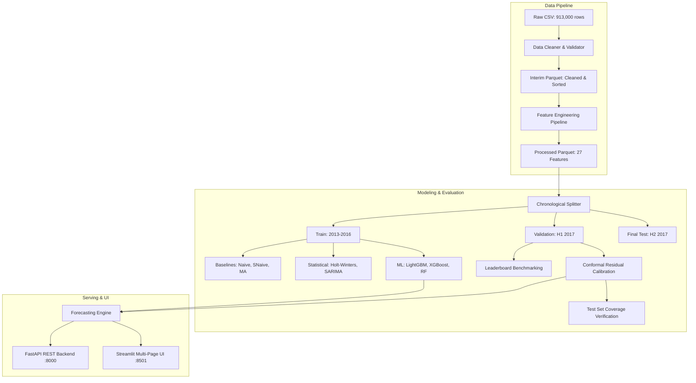

# ChronosCast — System Architecture Document

## 1. System Overview
ChronosCast is an enterprise-grade time-series forecasting platform designed to process multi-series demand data, extract trend and seasonal features without data leakage, benchmark baselines against advanced machine learning models, calibrate conformal prediction intervals, and serve predictions via FastAPI and Streamlit.

## 2. Component Design

### 2.1 Data Layer (`chronoscast.data`)
- **Loader**: Ingests raw CSV with schema checks.
- **Validator**: 10-point audit verifying missing values, duplicates, temporal grid completeness ($10 \times 50 \times 1,826 = 913,000$ records), non-negative sales.
- **Cleaner**: Casts column dtypes to memory-efficient representations (`int32`, `float32`), strictly sorts by `(store, item, date)`, and persists compressed Parquet.

### 2.2 Feature Engineering Layer (`chronoscast.features`)
- **Group Isolation**: Every lag and rolling window calculation is grouped strictly by `(store, item)`.
- **Target Shift**: The target series is shifted by at least 1 day prior to computing rolling statistics to guarantee zero target leakage.
- **Calendar & Deterministic Trend**: Cyclical sine/cosine transforms for day-of-week and month, combined with monotonic `time_index`.

### 2.3 Model Layer (`chronoscast.models`)
- **Abstract Base Forecaster**: Unified `fit`, `predict`, `save`, and `load` interface.
- **Baselines**: Pure persistence Naive, 7-day Seasonal Naive, 7-day Moving Average.
- **Statistical Models**: Simple Exponential Smoothing, Holt's Linear Trend, Holt-Winters Seasonal Exponential Smoothing, ARIMA/SARIMA.
- **Machine Learning**: Global pooled LightGBM with histogram gradient boosting, Random Forest, and XGBoost.

### 2.4 Evaluation Layer (`chronoscast.evaluation`)
- **Chronological Split**: Train (2013-2016), Validation (H1 2017), Test (H2 2017).
- **Metrics**: MAE, RMSE, MAPE (zero protected), sMAPE (bounded), WAPE (volume weighted).
- **Leaderboard**: Automated ranking across validation windows.

### 2.5 Serving Layer (`api/` and `app/`)
- **FastAPI**: REST endpoints for health, dataset summary, store/item metadata, dynamic forecast generation, and model performance.
- **Streamlit**: 7-page analytical dashboard + Inventory Insights module powered by interactive Plotly visualizations.
